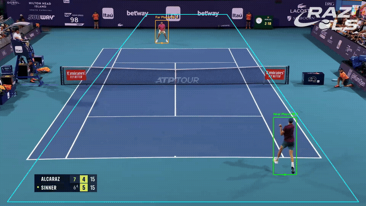
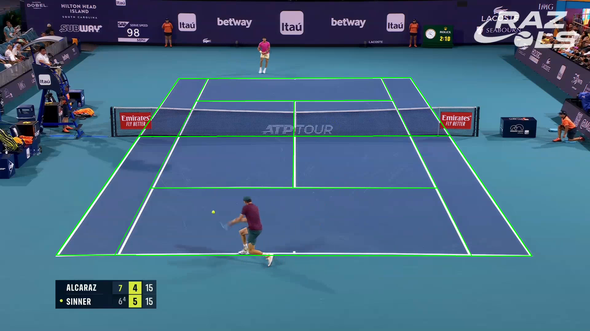
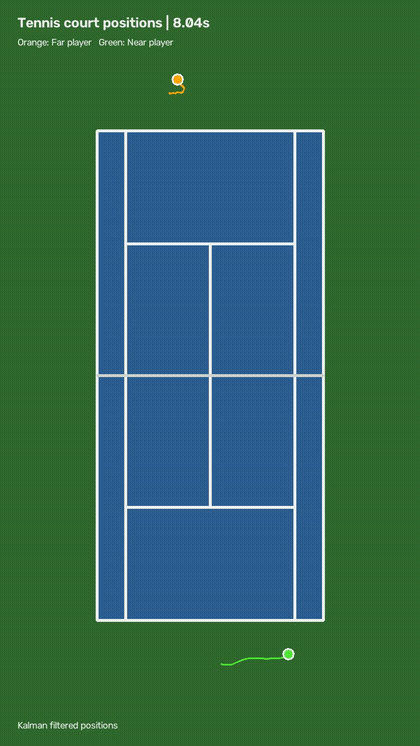

# Tennis Player Tracking and Court Position Estimation

A computer vision pipeline that tracks two tennis players in broadcast match footage and estimates their positions on a real-sized tennis court. Our goal was to go beyond drawing bounding boxes in an image and get usable `(x, y)` positions in meters over time.

The pipeline takes a match video and produces a labeled tracking video, JSON trajectories for both players, and an animated overhead court view.



## How it works

### 1. Detect and track players

We use a pretrained YOLO11n model to detect people in each frame and BoT-SORT to assign tracking IDs across frames. Since the video also contains line judges, spectators, and other people, we can't assume every single detected person is one of the two players.

To identify the two players, we use a polygon region of interest around the court, separate the near and far sides using the net, and count which track IDs appear most often during the first 60 frames. If BoT-SORT later gives a player a new ID, we're able to reassociate ids by looking for a detection on the correct side of the court that's close to the last known location.

For each player, we use the center of the bottom of their bounding box to approximate where their feet touch the court. This point is more better for estimating court position of the player rather than using the center of their body.

### 2. Convert pixels to court coordinates

The broadcast camera shows the court from its perspective, so distances in pixels don't directly represent real distances. We manually select the four outer doubles-court corners and match them to the dimensions of a tennis court (10.97 m × 23.77 m).

OpenCV then computes a homography, a 3×3 perspective transformation that maps image pixels to positions on the flat court. We save a separate calibration for each video so we don't have to select the corners again for videos with the same camera view.



### 3. Smooth trajectories and handle missing detections

We noticed that raw foot positions can jump between frames, especially if a bounding box changes or a player is briefly missed. To solve this, we implemented a constant-velocity Kalman filter for each player, using a state containing position `(x, y)` and velocity `(vx, vy)`.

On each frame, the filter predicts where the player should be based on their previous position and velocity. If a new detection is available, it combines that measurement with the prediction based on their uncertainties. But, if the detection is missing, it can continue predicting for up to 0.5 seconds before resetting instead of guessing indefinitely.

We save both the raw and filtered trajectories as JSON, including timestamps and court positions in meters.

### 4. Visualize and evaluate

We draw a top-down court to scale and plot both players' estimated positions, along with short trails showing their recent movement. To evaluate accuracies, we manually labeled the players' foot positions in selected frames and compared those annotations with the raw and filtered trajectories using Euclidean distances in meters.

## Results



We tested the pipeline on two clips from the same match. Both players were tracked and projected onto the overhead court. The first clip had several tracker ID changes that our reassociation logic handled. The second clip worked with its own calibration and had more consistent IDs.

For the first clip, we manually labeled 52 player positions (26 per player). There were 50 paired comparisons where both raw and filtered positions were available:

| Player | Raw mean error | Filtered mean error |
| --- | ---: | ---: |
| Far | 0.745 m | 0.749 m |
| Near | 0.413 m | 0.385 m |
| **Overall** | **0.579 m** | **0.567 m** |

The Kalman filter also recovered two missing detections in the annotated samples. It made the trajectories more continuous, but didn't always make them more accurate: overall mean error decreased slightly, while median error increased from 0.476 m to 0.551 m. This taught us that a smoother-looking path isn't necessarily a better position estimate.

These errors though are measured against manually clicked foot positions projected through the same homography, rather than independently measured court positions.

[Watch the side-by-side tracking and overhead demo](https://drive.google.com/file/d/15VH59yKQXT6zvau_Fb88m41vctjdaVoB/view?usp=sharing)

## Design decisions and challenges

**Keeping player identities consistent.** We initially tried regular multi-object tracking, but BoT-SORT sometimes lost a player and assigned them a new ID when they "reappeared." To solve this, instead of relying entirely on the tracker, we keep our own near and far player identities. When an ID disappears, we look for an unassigned detection on the same side of the court, close to the player's last known position. We also prefer detections inside the court region of interest. This worked well for our clips without needing to train a player-specific identification model, although it could still fail if players cross sides or disappear for too long.

**Using manual court calibration.** We considered trying to detect court lines automatically, but decided that four manually selected corners were a simpler and more reliable starting point for our footage. Once the homography is saved, the rest of the pipeline can reuse it. The tradeoff is that each new camera view needs its own calibration, and the mapping becomes less accurate if the camera pans or zooms.

**Getting reliable positions from detections.** The far-side player is much smaller in the image, so missed detections and small changes in the bounding box can have a noticeable effect on the estimated foot position. Even for the near-side player, the bottom of a bounding box isn't always the exact point touching the ground, especially during for example a jump. Those errors then get transformed into court coordinates. We used a Kalman filter to reduce some of that noise and fill short gaps, but it introduces its own tradeoff: if a player stops or changes direction quickly, a constant-velocity prediction can lag behind the actual movement. Our evaluation helped us see that smoothing improved continuity more clearly than it improved numerical accuracy.

## What we'd improve

With more time, we'd add automatic court-line detection and update the homography when the camera moves. We'd also improve reassociation using appearance features or predicted motion, test on footage from different matches and camera angles, and tune the Kalman filter with more manually labeled data. Once player tracking is reliable, ball tracking and rally detection would probably be the best next steps.

## What we learned / connection to robotics

Our biggest takeaway was that detecting an object is only the first step. We also had to maintain consistent identities, convert measurements into a useful coordinate system, deal with missing or noisy observations, and actually evaluate the output. Working through those stages separately made debugging much easier because we could tell whether a problem came from detection, tracking, calibration, or filtering.

This is similar to perception in real robotic systems. A robot may detect a person with a camera, track them across frames, estimate their position in a world coordinate system, and predict their movement when they are temporarily out of view. Of course, in our case the camera is fixed rather than mounted on a moving robot, but the problems surroudning tracking, transformations, and uncertainty are very closely related.

## Running the project

Place a match video in `data/raw/` (the raw videos we used aren't included in the repo). Calibration files for our two test clips are in `data/calibration/`. For a new fixed camera view, run `src/calibrate_court.py` first and select the four outer court corners.

```bash
python -m venv .venv
source .venv/bin/activate
pip install -r requirements.txt

python src/identify_players.py --video sinner_alcaraz_1.mp4
python src/smooth_trajectories.py --input outputs/sinner_alcaraz_1_trajectories.json
python src/visualize_court.py --input outputs/sinner_alcaraz_1_trajectories_smoothed.json
```

To reproduce the evaluation on the first clip, run:

```bash
python src/evaluate_trajectories.py \
  --annotations data/annotations/sinner_alcaraz_1.json \
  --raw outputs/sinner_alcaraz_1_trajectories.json \
  --filtered outputs/sinner_alcaraz_1_trajectories_smoothed.json
```

The tracking code currently uses an NVIDIA GPU with CUDA. All generated videos and trajectory JSON files are saved in `outputs/`.